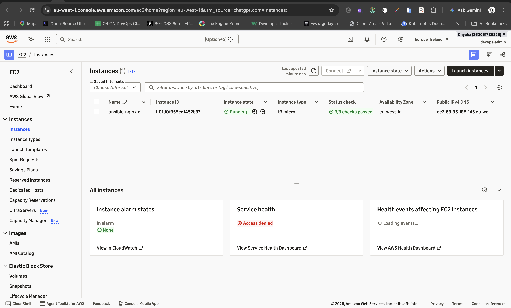
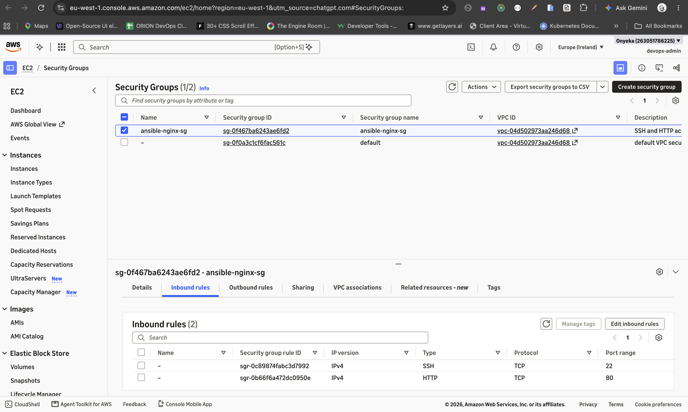
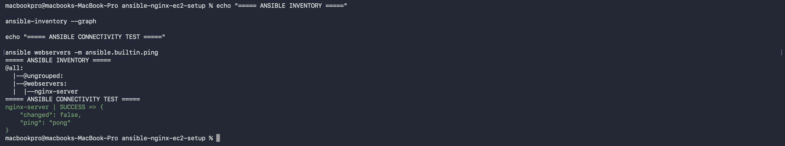
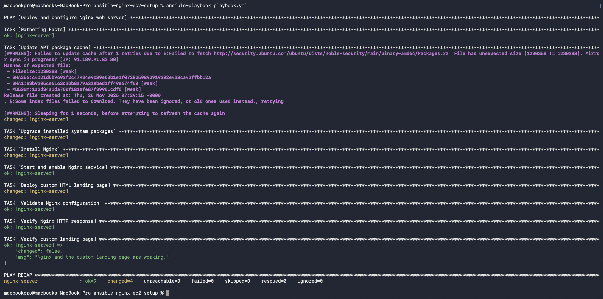
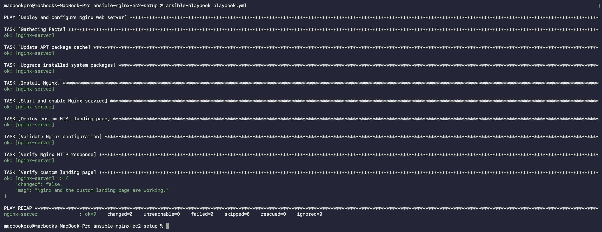
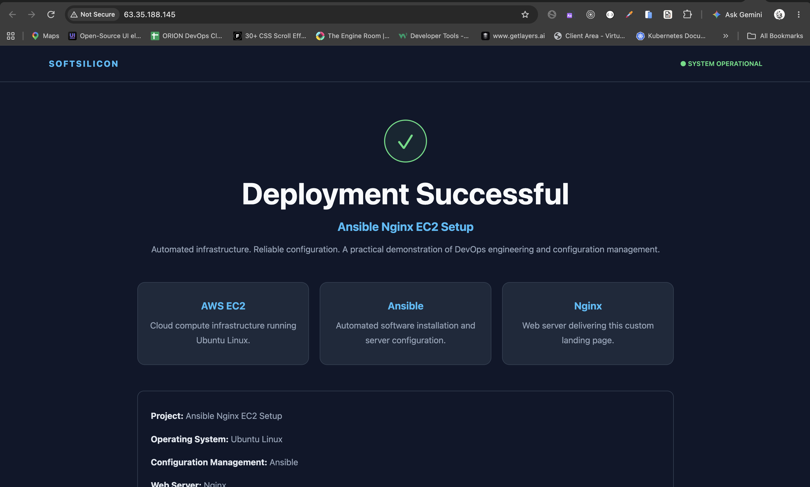

# Ansible Nginx EC2 Setup

A practical DevOps engineering project demonstrating automated
AWS infrastructure provisioning, secure SSH authentication,
configuration management, and idempotent application deployment
using Ansible.

## Project Objectives

- Provision an Amazon EC2 instance.
- Configure secure network access using AWS Security Groups.
- Establish SSH key-based authentication.
- Automate software installation and configuration using Ansible.
- Deploy a custom HTML landing page using Nginx.
- Demonstrate configuration management idempotency.
- Validate deployment through a public HTTP endpoint.
- Clean up AWS resources to avoid unnecessary charges.

## Architecture

    Local MacBook Pro
          |
          | AWS CLI - Infrastructure provisioning
          |
          v
    AWS EC2 - Ubuntu 24.04 LTS
          |
          | SSH Port 22 - Restricted source IP
          | Ansible configuration management
          |
          v
    Nginx Web Server
          |
          | HTTP Port 80
          |
          v
    Public Browser Access

## Technology Stack

| Technology | Purpose |
|------------|---------|
| AWS EC2 | Cloud compute infrastructure |
| AWS CLI | Infrastructure provisioning and cleanup |
| Ubuntu 24.04 LTS | Server operating system |
| Ansible Core 2.21.4 | Configuration management |
| Nginx 1.24.0 | Web server |
| SSH ED25519 | Secure authentication |
| YAML | Ansible playbook |
| HTML and CSS | Custom landing page |
| Bash | Infrastructure automation |
| Git and GitHub | Version control |

## Infrastructure Configuration

| Resource | Configuration |
|----------|---------------|
| AWS Region | eu-west-1 |
| Availability Zone | eu-west-1a |
| Instance Type | t3.micro |
| Operating System | Ubuntu 24.04 LTS |
| Storage | 8 GiB gp3 encrypted EBS |
| VPC | Existing default VPC |
| Instance Name | ansible-nginx-ec2 |
| Security Group | ansible-nginx-sg |
| SSH Key | ED25519 |
| Instance Metadata | IMDSv2 required |
| CPU Credits | Standard |
| Root Volume | Delete on termination |

## Security Configuration

The security group permits:

- TCP port 22 from the administrator's public IPv4 address only.
- TCP port 80 from all IPv4 addresses.

Additional security measures include:

- SSH key-based authentication.
- Passphrase-protected private SSH key.
- SSH private key permissions set to 600.
- SSH host key verification enabled.
- Encrypted EBS storage.
- IMDSv2 enforcement.
- AWS credentials and private keys excluded from version control.

AmazonEC2FullAccess was used temporarily for this learning
exercise. A production implementation should use a scoped
least-privilege IAM policy.

Public HTTP access is intended for this demonstration.
Production deployments should use HTTPS.

## Repository Structure

    ansible-nginx-ec2-setup/
    ├── ansible.cfg
    ├── inventory.ini
    ├── playbook.yml
    ├── files/
    │   └── index.html
    ├── scripts/
    │   ├── provision.sh
    │   └── cleanup.sh
    ├── screenshots/
    ├── .gitignore
    └── README.md

## Prerequisites

- AWS account with appropriate EC2 permissions.
- AWS CLI configured with an authenticated profile.
- Ansible installed locally.
- OpenSSH installed.
- Git installed.
- An existing VPC and public subnet.

Review the provisioning script and update the AWS profile,
region, VPC ID, subnet ID and AMI ID for your environment
before executing it.

AWS resources may incur charges.

## SSH Key Generation

    ssh-keygen -t ed25519 \
      -f ~/.ssh/ansible-nginx-ec2 \
      -C "ansible-nginx-ec2-setup"

    chmod 600 ~/.ssh/ansible-nginx-ec2

    ssh-add ~/.ssh/ansible-nginx-ec2

The private key must never be committed to GitHub.

## Infrastructure Provisioning

Authenticate with AWS:

    aws login --profile devops-admin

Validate the AWS identity:

    aws sts get-caller-identity --profile devops-admin

Provision the infrastructure:

    chmod +x scripts/provision.sh
    ./scripts/provision.sh

The provisioning script:

1. Detects the administrator's public IPv4 address.
2. Creates a dedicated security group.
3. Configures SSH and HTTP inbound rules.
4. Imports the SSH public key.
5. Launches an Ubuntu EC2 instance.
6. Updates the Ansible inventory.
7. Records resource identifiers locally.
8. Waits for EC2 status checks.

## Ansible Inventory

The inventory defines the EC2 instance under the webservers
host group and specifies the Ubuntu SSH user, private key
location and Python interpreter.

The public IP recorded during the original deployment was:

    63.35.188.145

This address is historical deployment evidence and may no
longer be accessible after infrastructure cleanup.

## SSH Connectivity

    source .aws-resources.env

    ssh -i ~/.ssh/ansible-nginx-ec2 ubuntu@"$EC2_IP"

Verify the server's SSH host fingerprint before accepting it.

## Ansible Connectivity

    ansible-inventory --graph

    ansible webservers -m ansible.builtin.ping

## Playbook Execution

Validate the playbook:

    ansible-playbook playbook.yml --syntax-check

Execute the deployment:

    ansible-playbook playbook.yml

The playbook performs the following operations:

1. Gather server facts.
2. Update the APT package cache.
3. Upgrade installed system packages.
4. Install Nginx.
5. Start and enable the Nginx service.
6. Deploy the custom HTML landing page.
7. Validate the Nginx configuration.
8. Verify the HTTP response.
9. Assert that the expected HTML content is served.

## Deployment Results

First successful execution:

    ok=9 changed=4 unreachable=0 failed=0
    skipped=0 rescued=0 ignored=0

The initial deployment successfully configured the server
and deployed the custom HTML landing page.

## Idempotency Verification

A subsequent successful execution returned:

    ok=9 changed=0 unreachable=0 failed=0
    skipped=0 rescued=0 ignored=0

The zero-change result demonstrates that the server was
already in the desired configuration state.

Future package updates may legitimately introduce changes.

## Public HTTP Validation

    source .aws-resources.env

    curl -I "http://$EC2_IP"

Verified results:

- HTTP status: 200 OK
- Web server: Nginx 1.24.0 (Ubuntu)
- Nginx service: active
- Nginx startup configuration: enabled
- Custom HTML content: successfully served

## Troubleshooting

### Ubuntu Repository Synchronization Warning

During the first playbook execution, an APT package index
download returned an unexpected file size.

Ansible automatically retried the package cache update
and completed successfully.

No package integrity checks were disabled.

### Ansible Privilege Escalation Timeout

An immediate repeat execution encountered a timeout while
waiting for the privilege escalation prompt.

A subsequent execution completed successfully without
requiring configuration changes.

The exact cause was not established.

The successful repeat execution returned changed=0,
unreachable=0 and failed=0.

## Deployment Evidence

### EC2 Instance

### Security Group Rules

### SSH Authentication

### Ansible Connectivity

### Playbook Execution

### Idempotency Verification

### Public Website Validation

## Infrastructure Cleanup

The cleanup script terminates the EC2 instance and removes
the project security group and AWS key pair.

    ./scripts/cleanup.sh

Type DESTROY when prompted to confirm.

Verify that no project EC2 instances, EBS volumes, network
interfaces or other billable resources remain.

The existing default VPC and subnets are preserved.

Remove temporary IAM permissions and log out of the AWS CLI
after cleanup.

## Key Learning Outcomes

- Cloud infrastructure provisioning using AWS CLI.
- Secure network access using security groups.
- SSH key-based remote administration.
- Ansible inventory and playbook development.
- Declarative configuration management.
- Idempotent software deployment.
- Infrastructure troubleshooting.
- AWS resource lifecycle and cost management.

## Author

Ibeh Franklin Onyeka

Software Engineer | DevOps Engineering

GitHub: https://github.com/ifobook

## Final Resource Cleanup Verification

Cleanup completed successfully on November 26, 2026.

| Resource | Final Status |
|----------|--------------|
| EC2 instance | Terminated |
| EBS volumes | None remaining |
| Security group | Deleted |
| AWS SSH key pair | Deleted |
| Network interfaces | None remaining |
| Default VPC | Preserved |
| Temporary IAM permissions | Revoked |

All project infrastructure was removed to prevent
ongoing resource charges. Deployment screenshots are
retained as historical evidence.
